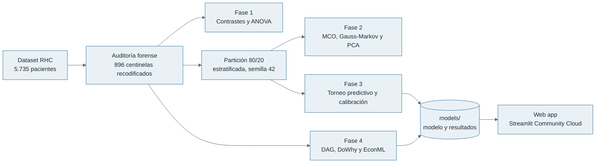
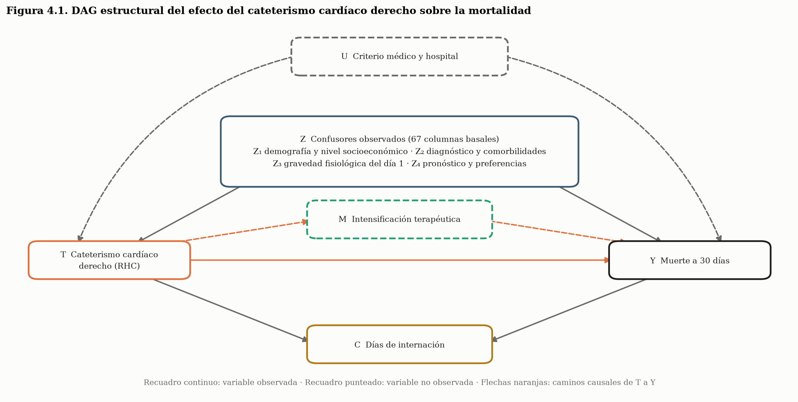
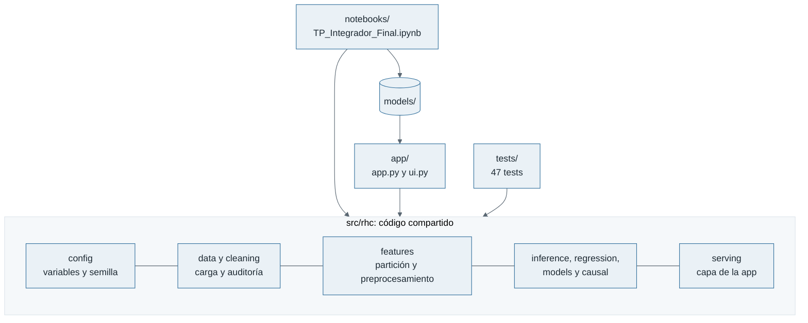
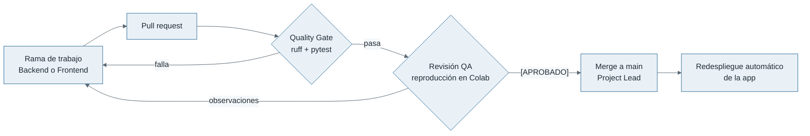

# Cateterismo cardíaco derecho: predicción y decisión causal


**Trabajo Práctico Integrador. Estadística Avanzada y Modelos de Regresión (EAyMR 2026), UCA.**

Este proyecto evalúa si el cateterismo cardíaco derecho (RHC) aplicado en las primeras 24 horas de internación modifica la mortalidad a 30 días de pacientes críticos. Distingue dos preguntas:

| Pregunta | Formalización | Fase |
|---|---|---|
| ¿Qué paciente tiene mayor riesgo de morir? | P(Y \| X) | Fase 3: torneo predictivo |
| ¿Qué pasaría si se le aplica RHC? | P(Y \| do(T = 1)) | Fase 4: inferencia causal |

**App en producción:** [tp-integrador-rhc.streamlit.app](https://tp-integrador-rhc.streamlit.app/)
**Notebook:** [`notebooks/TP_Integrador_Final.ipynb`](notebooks/TP_Integrador_Final.ipynb) · [Abrir en Colab](https://colab.research.google.com/github/Valentina-Bolivar/tp-integrador-rhc/blob/main/notebooks/TP_Integrador_Final.ipynb)
**Bitácora:** [`BITACORA.md`](BITACORA.md)

## Equipo y roles Scrum

| Rol | Responsable |
|---|---|
| Project Lead & Scrum Master | Valentina Bolívar |
| Backend & Machine Learning / Causal Engineer | Valentina Bolívar |
| Frontend & UI/UX Engineer | Felicitas Paz |
| QA & Validation Engineer | Emilia Bedners |

**Regla de integración:** ningún pull request se incorpora a `main` sin el veredicto **[APROBADO]** del QA Engineer y la verificación automática del Quality Gate.

## Estado del proyecto

| Fase | Contenido | Estado |
|---|---|---|
| 0 | Estructura, contrato de datos, Quality Gate | Completa |
| 1 | Auditoría forense, EDA, contrastes de hipótesis, ANOVA | Completa |
| 2 | MCO, diagnóstico de Gauss-Markov, Cook, VIF, PCA sin fuga | Completa |
| 3 | Torneo de ML y calibración | Completa |
| 4 | DAG, DoWhy, EconML, refutaciones, ensayo crítico | Completa |
| 5 | Web app (diagnóstico, predicción y simulación causal) | Completa y desplegada |

## Estructura del repositorio

```
├── .streamlit/           Tema visual de la web app
├── app/                  Web app en Streamlit (app.py, ui.py y tipografía en static/)
├── data/                 Dataset original y diccionario de variables
├── models/               Modelos serializados (joblib / json)
├── notebooks/            Notebook maestro reproducible
├── reports/figures/      Figuras exportadas
├── src/rhc/              Código modular reutilizado por el notebook y la app
├── tests/                Tests automáticos (pytest)
├── .github/workflows/    Quality Gate (ruff + pytest en cada pull request)
├── BITACORA.md           Bitácora de ingeniería
├── requirements.txt      Dependencias fijadas
└── requirements-dev.txt  Herramientas de calidad
```

## Cómo está construido

### Flujo del análisis

La auditoría de datos alimenta a las cuatro fases. Las Fases 2 y 3 trabajan sobre una única partición 80/20, de modo que ningún parámetro se estima con el conjunto de test. Las Fases 1 y 4 usan la muestra completa, porque no evalúan predicciones fuera de muestra. El modelo final y los resultados causales se guardan en `models/`, de donde los lee la web app.



### Supuestos causales

El grafo dirigido acíclico de la Fase 4 declara qué causa qué. Los confusores observados $Z$ influyen en la decisión de cateterizar y en la mortalidad; ajustar por ellos bloquea los caminos de puerta trasera. La intensificación terapéutica $M$ es un mediador y los días de internación $C$ son un colisionador: ninguno de los dos entra en el conjunto de ajuste. El criterio médico y el hospital $U$ no se observan, y su posible efecto se acota con el E-value.



### Arquitectura del código

Todo el código reutilizable vive en `src/rhc`. El notebook, la web app y los tests importan las mismas funciones, de modo que una corrección en un módulo se propaga a los tres y queda cubierta por el Quality Gate.



### Flujo de trabajo del equipo

Ningún cambio llega a `main` sin pasar el Quality Gate y la revisión del QA Engineer. Cada merge en `main` redespliega la app automáticamente.



## Web app

La aplicación lee los artefactos que el notebook guarda en `models/` y no reestima los modelos. Tiene cuatro secciones:

| Sección | Contenido |
|---|---|
| Diagnóstico y exploración | Filtros por diagnóstico, gravedad, edad y tratamiento; indicadores; inspector de variables con diferencia de medias estandarizada; proyección de los pacientes en el plano CP1-CP2 con el PCA ajustado en entrenamiento; auditoría de centinelas; descarga de la muestra filtrada |
| Predicción del riesgo (*What-Is*) | Perfil editable o paciente real del conjunto de test; probabilidad de muerte a 30 días con intervalo bootstrap del 95 %; umbral de clasificación ajustable con sensibilidad y especificidad; aporte de cada variable al riesgo del paciente; diagrama de calibración |
| Simulación causal (*What-If*) | Balance de confusores antes y después de ponderar; superposición de propensiones; DAG interactivo con cinco vistas (caminos causales, puerta trasera, colisionador, mediador); curva de CATE según el perfil; efecto por diagnóstico; impacto de una política; semáforo de las tres refutaciones y E-value |
| Sobre el trabajo | Pregunta, datos, método, límites, equipo y referencias |

## Reproducción

**En Google Colab:** abrir el notebook con el enlace "Abrir en Colab" y elegir la opción *Ejecutar todas* del menú *Entorno de ejecución*. La primera celda descarga el repositorio dentro de Colab (el notebook necesita el código de `src/rhc` y el dataset de `data/raw`) e instala las versiones fijadas en `requirements.txt`. En la primera ejecución, si Colab ya tenía cargadas otras versiones de las librerías, la celda reinicia la sesión automáticamente; en ese caso se vuelve a elegir *Ejecutar todas* y la segunda ejecución corre completa. Para revisar un pull request antes de integrarlo, se abre el notebook desde la rama del pull request y se reemplaza `BRANCH = "main"` por el nombre de esa rama.

**En una computadora local (Python 3.12):**

```bash
python -m venv .venv
source .venv/bin/activate        # en Windows: .venv\Scripts\activate
pip install -r requirements-dev.txt
pytest                           # Quality Gate local
ruff check src tests app
jupyter nbconvert --execute --to notebook --inplace notebooks/TP_Integrador_Final.ipynb
streamlit run app/app.py
```

Semilla global: `SEED = 42` (definida en `src/rhc/config.py`).

## Datos

Connors, A. F., et al. (1996). *JAMA, 276*(11), 889–897. Detalle y diccionario en [`data/README.md`](data/README.md).
